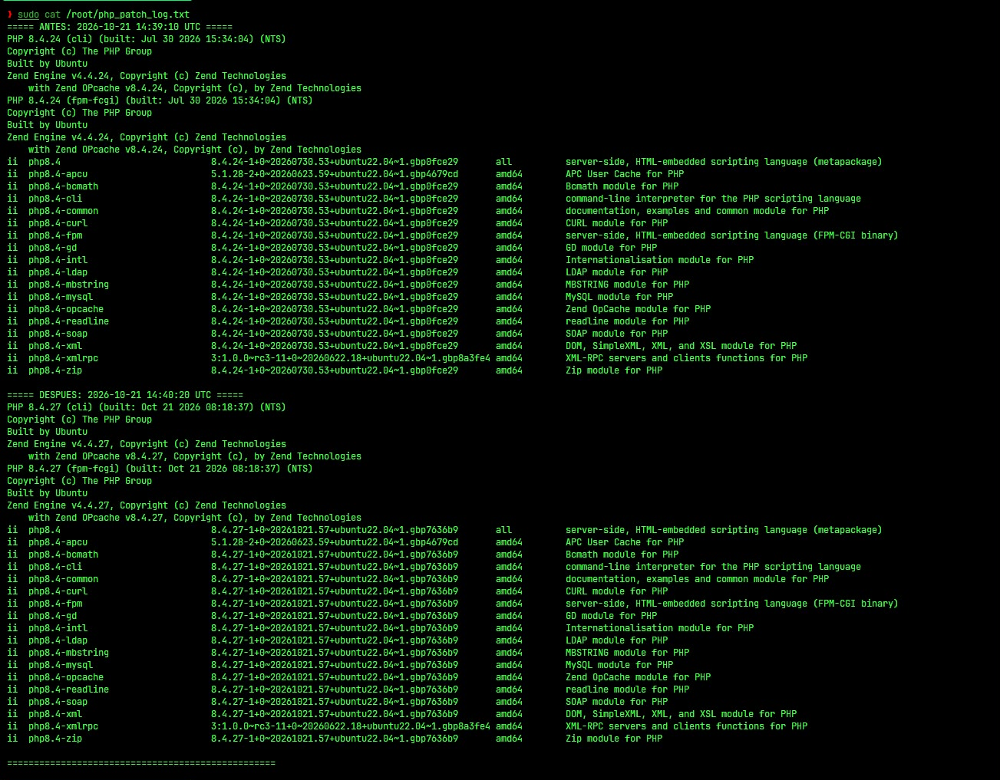

# patch_php.sh

Script para aplicar actualizaciones de seguridad de PHP en servidores
Debian/Ubuntu (VPS propios, no hosting compartido/cPanel gestionado por
terceros), con registro automático de la versión antes y después de
la actualización.

Nació a partir del parche de emergencia de PHP del 21 de octubre de
2026 (CVE-2026-109618 y CVE-2026-109619), pero sirve para cualquier
actualización de seguridad de PHP futura.

## Contexto

El 21 de octubre de 2026 el proyecto PHP publicó las versiones
**8.5.12, 8.4.27, 8.3.36 y 8.2.35**, que corrigen dos vulnerabilidades
críticas de ejecución remota de código (CVSS 9.2):

- **CVE-2026-109618** ([GHSA-w8hw-w9fx-j79w](https://github.com/php/php-src/security/advisories/GHSA-w8hw-w9fx-j79w)):
  corrupción de memoria al alcanzar `memory_limit`. En Apache con
  mod_php, una petición sin autenticar puede dispararla antes de que
  corra código de la aplicación. También se confirmó RCE en PHP-FPM
  mediante rutas de código de la aplicación.
- **CVE-2026-109619** ([GHSA-6wmf-4rv5-p3rp](https://github.com/php/php-src/security/advisories/GHSA-6wmf-4rv5-p3rp)):
  estado obsoleto tras un error fatal que permite un use-after-free en
  una petición posterior del mismo worker.

Fuentes oficiales:

- [Anuncio en php.net](https://www.php.net/archive/2026.php#2026-10-21-5)
- [Post de The PHP Foundation](https://thephp.foundation/blog/2026/10/21/todays-php-security-release-and-how-were-strengthening-php-security/)

## Ejemplo real

Salida del log en un servidor Ubuntu 22.04, antes y después de correr
el script (PHP 8.4.24 → 8.4.27, CLI y FPM):



## Qué hace

1. Verifica que se ejecute como `root` y aborta si no.
2. Detecta automáticamente la versión de PHP instalada (`php -r`).
3. Detecta si usás PHP-FPM, y si tu servidor web es Apache o Nginx.
4. Registra un snapshot "ANTES" (versión de PHP, PHP-FPM y paquetes dpkg)
   en un log con timestamp UTC.
5. Ejecuta `apt update` y `apt install --only-upgrade` solo sobre los
   paquetes `phpX.Y*` y `libapache2-mod-phpX.Y` (si usás mod_php), en
   modo no interactivo y conservando tus archivos de configuración
   (`--force-confold`).
6. Reinicia PHP-FPM y el servidor web detectado (esto es crítico: sin
   reiniciar, el binario viejo puede seguir corriendo en memoria aunque
   el paquete ya esté actualizado).
7. Registra un snapshot "DESPUÉS" y verifica con `/proc/<PID>/exe` que el
   proceso FPM en ejecución use el binario nuevo (si aparece `(deleted)`,
   sigue corriendo el viejo).

## Uso

```bash
chmod +x patch_php.sh
sudo ./patch_php.sh
```

El log queda en `/var/log/php_patch_log.txt` (podés cambiar la ruta
editando la variable `LOG_FILE` al inicio del script).

Al terminar, compará la versión del snapshot "ANTES" con la del
"DESPUÉS" y con la versión corregida publicada en php.net para tu rama.

## Requisitos / supuestos

- Debian o Ubuntu con PHP instalado vía `apt` (paquete de la distro o
  repositorio de terceros como Sury/Ondřej).
- Permisos de `root` o `sudo`.
- El nombre del paquete de PHP sigue el patrón estándar `phpX.Y`
  (como lo nombran Debian/Ubuntu y el repo de Sury).
- Que tu repositorio ya haya publicado el paquete corregido. Si todavía
  no lo hizo, `apt` no va a encontrar nada nuevo y la versión no
  cambia: por eso el log "DESPUÉS" es importante.
- Si un paquete trae cambios en un archivo de configuración, el script
  conserva tu versión actual (`--force-confold`). Revisá después si el
  paquete nuevo trae opciones que te interesen.
- El log se va acumulando (append): cada corrida agrega bloques ANTES/DESPUÉS.

## Qué NO hace

- No resuelve el caso de hosting compartido / cPanel administrado por
  un tercero: ahí depende del proveedor, no de este script.
- **No actúa sobre PHP 8.1 o anterior (EOL).** El script detecta esto
  al inicio y aborta con una advertencia explícita, en vez de fallar
  en silencio o dar una falsa sensación de que quedaste parcheado.
  El proyecto PHP no publica correcciones para 8.1 y ramas anteriores;
  la opción es migrar a una rama soportada (8.2 o superior) o consultar
  si el mantenedor de tu distribución ofrece un paquete con el fix
  portado.
- No reemplaza tener un backup antes de actualizar. **Hacé tu backup
  primero, siempre**, y si podés probá antes en un entorno de staging.
- No es un escáner de vulnerabilidades ni valida si tu sistema está
  comprometido: solo automatiza el parcheo y su verificación.

## Por qué existe

Durante incidentes de seguridad críticos (como el de octubre de 2026),
la diferencia entre quedar expuesto o no se mide en minutos. Este
script elimina la fricción de "actualizar a mano, revisar versión,
reiniciar, revisar de nuevo" y deja evidencia clara (el log) de que
el parche se aplicó y se verificó, útil tanto para vos como para
mostrarle a un cliente o equipo que el trabajo se hizo.

## Contacto

¿Necesitás parchear o revisar tus servidores PHP/Linux?
Ofrezco parcheo con informe antes/después, auditoría básica y
configuración de servidores (VPS).

- Email: izdirtxhx@proton.me
- X: @IzDirtHxH

## Licencia

MIT: usalo, modificalo y compartilo libremente. Ver el archivo
[LICENSE](LICENSE).
